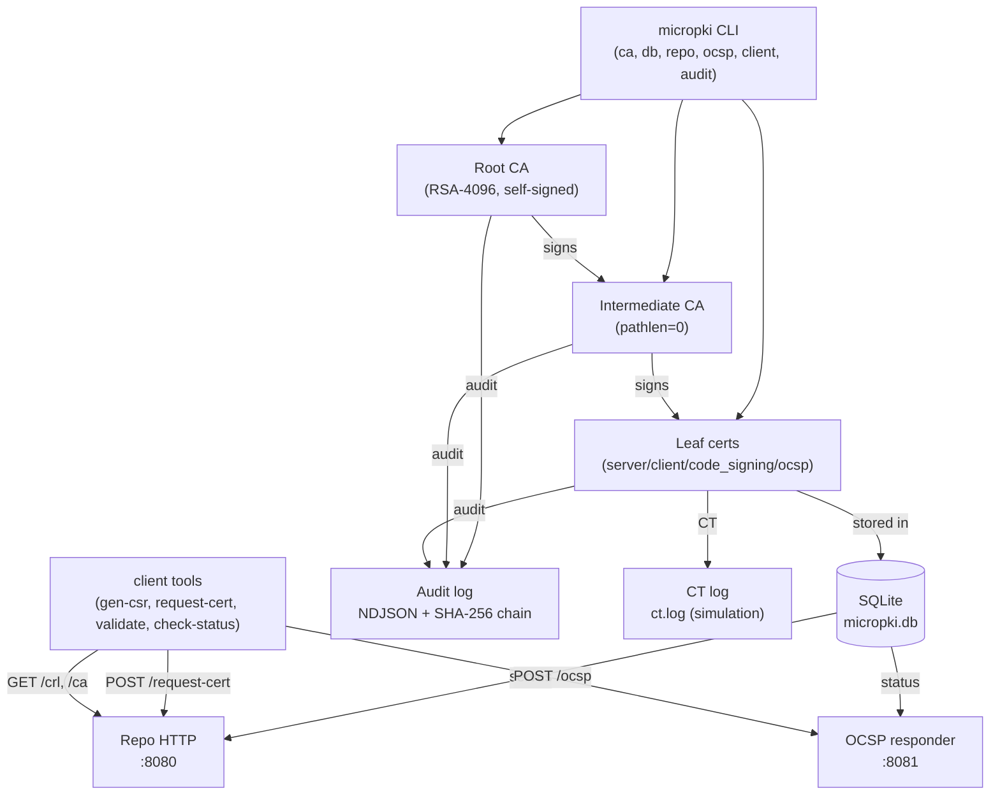

## MicroPKI
A minimal representation of PKI (Public Key Infrastructure) utility based on Python, that creates self-signed Root CA and generates certificate.

## Dependencies
- **Python**>=3.9
- **cryptography**>=42.0.0
- **pytest**>=7.0.0
- **asn1crypto**>=1.5.1

## Features
- **Root CA** — self-signed, RSA-4096 / ECC P-384, encrypted key (PKCS#8), `policy.txt`.
- **Intermediate CA** — CSR-based, `pathLenConstraint=0`, encrypted key.
- **Leaf certificates** — `server` / `client` / `code_signing` / `ocsp`, correct `BasicConstraints`, `KeyUsage`, `ExtendedKeyUsage`, SANs.
- **SAN parsing** — `dns:`, `ip:`, `email:`, `uri:` with per-template whitelists.
- **External CSR signing** — `--csr` (subject and SANs taken from the CSR).
- **SQLite DB** — unique 64-bit serials, `list-certs`, `show-cert`, auto-insert on issue.
- **CRLv2** — `ca revoke`, `ca gen-crl`, CRL number, AKI, reason codes, `GET /crl`.
- **OCSP responder** — delegated responder cert (`EKU=OCSPSigning`), nonce echo, in-memory cache, `POST /ocsp`.
- **Client tools** — `gen-csr`, `request-cert`, `validate` (path building), `check-status` (OCSP→CRL fallback).
- **Tamper-evident audit** — NDJSON + SHA-256 hash chain, `audit verify`, `audit query`, `chain.dat`.
- **Policies** — key sizes, validity caps, SAN/wildcard rules, SHA-1 CSR rejection.
- **Rate limiting** — per-IP token bucket, `429` + `Retry-After`.
- **CT log simulation** — `audit/ct.log`, `audit ct-verify`.
- **Key compromise simulation** — `ca compromise`, `compromised_keys` table, blocks key reuse, emergency CRL.
- **TLS + code-signing demos** — documented end-to-end.

## Installation
```bash
git clone {repository_url}
cd MicroPKI
python -m venv .venv
source .venv/bin/activate
pip install -r requirements.txt
pip install -e .
```
## How to start
**1) Initialize Root CA and Database**
```bash
mkdir -p secrets
echo "my-cool-passphrase" > secrets/root.pass
chmod 600 secrets/root.pass

micropki db init --db-path ./pki/micropki.db

micropki ca init \
  --subject "CN=Test Root CA,O=TestOrg,C=RU" \
  --key-type rsa --key-size 4096 \
  --passphrase-file secrets/root.pass \
  --out-dir ./pki \
  --validity-days 3650 \
  --log-file ./pki/ca.log
```
**2) Issue Intermediate CA**
```bash
echo "intermediate-passphrase" > secrets/intermediate.pass
chmod 600 secrets/intermediate.pass

pmicropki ca issue-intermediate \
  --root-cert ./pki/certs/ca.cert.pem \
  --root-key ./pki/private/ca.key.pem \
  --root-pass-file secrets/root.pass \
  --subject "CN=Test Intermediate CA,O=TestIntrOrg" \
  --key-type rsa --key-size 4096 \
  --passphrase-file secrets/intermediate.pass \
  --out-dir ./pki \
  --validity-days 1825 \
  --pathlen 0 \
  --db-path ./pki/micropki.db \
  --log-file ./pki/ca.log
```
**3) Issue certificates**
```bash
#Server certificate (dns: of ip: SAN is required)
micropki ca issue-cert \
  --ca-cert ./pki/certs/intermediate.cert.pem \
  --ca-key ./pki/private/intermediate.key.pem \
  --ca-pass-file secrets/intermediate.pass \
  --template server \
  --subject "CN=example.com,O=MyTestOrg" \
  --san dns:example.com --san dns:www.example.com --san ip:192.168.1.10 \
  --out-dir ./pki/certs \
  --validity-days 365 \
  --db-path ./pki/micropki.db \
  --log-file ./pki/ca.log
    
#Client certificate (email:)
micropki ca issue-cert \
  --ca-cert ./pki/certs/intermediate.cert.pem \
  --ca-key ./pki/private/intermediate.key.pem \
  --ca-pass-file secrets/intermediate.pass \
  --template client \
  --subject "CN=Ivanov Ivan" \
  --san email:IIvan0ff@example.com \
  --out-dir ./pki/certs \
  --validity-days 365 \
  --db-path ./pki/micropki.db \
  --log-file ./pki/ca.log

#Code signing (only dns: or uri:)
micropki ca issue-cert \
  --ca-cert ./pki/certs/intermediate.cert.pem \
  --ca-key ./pki/private/intermediate.key.pem \
  --ca-pass-file secrets/intermediate.pass \
  --template code_signing \
  --subject "CN=Code Signer" \
  --san dns:signer.example.com \
  --out-dir ./pki/certs \
  --validity-days 365 \
  --db-path ./pki/micropki.db \
  --log-file ./pki/ca.log
```
**4) Query certificates**
```bash
## List all certificates
micropki ca list-certs --db-path ./pki/micropki.db

## Filter status
micropki ca list-certs --status valid --format table

## Export in JSON, CSV or table format
micropki ca list-certs --format table
micropki ca list-certs --format json
micropki ca list-certs --format csv

## Show certificate by its serial
micropki ca show-cert <serial> --db-path ./pki/micropki.db
```
**5) Revocation and CRL**
```bash
micropki ca revoke <serial> --reason keyCompromise --force \
  --ca-pass-file secrets/intermediate.pass \
  --cert-dir ./pki/certs --private-dir ./pki/private \
  --db-path ./pki/micropki.db --out-dir ./pki

micropki ca gen-crl --ca intermediate \
  --ca-pass-file secrets/intermediate.pass \
  --out-dir ./pki --db-path ./pki/micropki.db

openssl crl -in pki/crl/intermediate.crl.pem -text -noout
openssl crl -in pki/crl/intermediate.crl.pem \
  -CAfile pki/certs/intermediate.cert.pem -noout
```

**6) OCSP Responder**
```bash
# Issue OCSP certificate
micropki ca issue-ocsp-cert \
  --ca-cert ./pki/certs/intermediate.cert.pem \
  --ca-key ./pki/private/intermediate.key.pem \
  --ca-pass-file secrets/intermediate.pass \
  --subject "CN=ocsp-responder,O=Demo" \
  --key-type rsa --key-size 2048 --san dns:localhost \
  --out-dir ./pki/certs --validity-days 365 \
  --db-path ./pki/micropki.db

# Start server
micropki ocsp serve --host 127.0.0.1 --port 8081 \
  --db-path ./pki/micropki.db \
  --responder-cert ./pki/certs/ocsp-responder.cert.pem \
  --responder-key  ./pki/certs/ocsp-responder.key.pem \
  --ca-cert ./pki/certs/intermediate.cert.pem \
  --cache-ttl 60

# Send request
openssl ocsp -issuer pki/certs/intermediate.cert.pem \
  -cert pki/certs/example.com.cert.pem \
  -url http://127.0.0.1:8081/ocsp \
  -VAfile pki/certs/ocsp-responder.cert.pem -resp_text
```

**7) Start repository server**
```bash
micropki repo serve --host 127.0.0.1 --port 8080 \
  --db-path ./pki/micropki.db --cert-dir ./pki/certs \
  --ca-private-dir ./pki/private --ca-pass-file secrets/intermediate.pass \
  --api-key changeme --rate-limit 5 --rate-burst 10
```
Endpoints:
```bash
#Root CA
curl -s http://localhost:8080/ca/root
#Intermediate CA
curl -s http://localhost:8080/ca/intermediate
# Certificate by serial
curl -s http://localhost:8080/certificate/<serial>
# CRL
curl -s http://localhost:8080/crl?ca=intermediate
```

**8) Client tools**
Need both OCSP and repository servers launched on background
```bash
# CRL generation
micropki client gen-csr --subject "CN=app.example.com,O=MyOrg" \
  --key-type rsa --key-size 2048 --san dns:app.example.com \
  --out-key ./app.key.pem --out-csr ./app.csr.pem
# Certificate request
micropki client request-cert --csr ./app.csr.pem --template server \
  --ca-url http://localhost:8080 --out-cert ./app.cert.pem --api-key password
# Certificate validation
micropki client validate --cert ./app.cert.pem \
  --untrusted ./pki/certs/intermediate.cert.pem \
  --trusted ./pki/certs/ca.cert.pem \
  --crl http://localhost:8080/crl?ca=intermediate --ocsp --mode full
# Show certificate status
micropki client check-status --cert ./app.cert.pem \
  --ca-cert ./pki/certs/intermediate.cert.pem \
  --ocsp-url http://127.0.0.1:8081/ocsp \
  --crl ./pki/crl/intermediate.crl.pem
```

**Audit and security**
## Audit Log
All security-critical operations (`ca_init`, `issue_intermediate`,
`issue_certificate`, `issue_ocsp_cert`, `key_compromise`, `revoke`, `gen_crl`,policy violations) are appended to `pki/audit/audit.log` in **NDJSON** (one JSON object per line) with a **SHA-256 hash chain**:

```json
{
  "timestamp": "2026-11-05T15:08:42.025000+00:00",
  "level": "AUDIT",
  "operation": "issue_certificate",
  "status": "success",
  "message": "Leaf certificate issued",
  "metadata": {
    "template": "code_signing",
    "serial": "0x6aec9bfa1e0b919c",
    "subject": "O=Demo,CN=Demo Code Signer",
    "sans": ["dns:signer.example.com"]
  },
  "integrity": {
    "prev_hash": "d1d1703c...",
    "hash": "3b5341e7..."
  }
}
```
  - `integrity.prev_hash` — SHA-256 of the previous record (or "0"*64 for the first).

  - `integrity.hash` — SHA-256 of the canonical JSON of the current record,
    excluding integrity.hash itself (keys sorted, no extra whitespace).

  - `pki/audit/chain.dat stores` the latest hash (one line, appended on every
    write) for fast verification.

The audit logger is separate from the application logger (--log-file,
plain JSON to stderr/file). Secrets (passphrases, private keys, tokens) are
never written to the audit log — log() filters keys matching
passphrase|password|secret|key_data|private_key|token.

## Security Policies
Enforced by `ca.issue-cert`, `ca.issue-intermediate`, `ca.init`, and CSR
processing:

|       Role       | RSA min | ECC min | Max validity | pathLenConstraint |
|------------------|---------|---------|--------------|-------------------|
| Root CA          | 4096    | P-384   | 3650 d       | n/a (None)        |
| Intermediate CA  | 4096    | P-384   | 1825 d       | **0** (must be 0) |
| Leaf             | 2048    | P-256   | 365 d        | n/a               |

SAN rules per template:

|     Template     | Allowed SAN types | Wildcard (`*.`) |    Required    |
|------------------|-------------------|-----------------|----------------|
|  `server`        | dns, ip           | rejected        | ≥ 1 dns or ip  |
|  `client`        | dns, email        | rejected (dns)  | email required |
|  `code_signing`  | dns, uri          | rejected (dns)  | —              |
|  `ocsp`          | dns, uri          | —               | —              |

Other checks:
- **SHA-1 CSRs are rejected**. RSA uses SHA-256; ECC P-384 uses SHA-384, P-256 uses SHA-256.
- **CSR key size is enforced** — an external CSR with RSA-1024 or ECC P-192 is rejected before signing.
- **Compromised keys are blocked** — any CSR whose SPKI hash is in `compromised_keys` is rejected.

On any violation the CA logs an `AUDIT` record with `status="failure"` and
returns a non-zero exit code. Nothing is written to disk or the DB.

## Certificate transparency simulation
Every issued certificate is appended to `pki/audit/ct.log` (plain text,
world-readable `0644` — this is a **simulation**):
```
2026-11-05T15:08:42+00:00|6aec9bfa1e0b919c|O=Demo,CN=Demo Code Signer|224a0aaa...|O=Demo,CN=Demo Intermediate CA
Format: `timestamp|serial_hex|subject_dn|sha256_fingerprint|issuer_dn`.
```
CT log is public, it contains no secrets, so it is written with mode 0644. The log is append-only, rotation is out of scope.

## Key Compromise Simulation

```bash
micropki ca compromise \
  --cert ./pki/certs/example.com.cert.pem \
  --reason keyCompromise \
  --ca-cert ./pki/certs/intermediate.cert.pem \
  --ca-key ./pki/private/intermediate.key.pem \
  --ca-pass-file ./secrets/intermediate.pass \
  --db-path ./pki/micropki.db --out-dir ./pki --force
```
Effects:

  1) The certificate is marked revoked with the given reason in certificates.

  2) SHA-256 of its SPKI is inserted into compromised_keys (public_key_hash, certificate_serial, compromise_date, compromise_reason).

  3) Any future CSR with the same public key is rejected at issuance: Public key is marked compromised.

  4) An emergency CRL for the issuing CA is regenerated.

  5) An AUDIT record is written with operation="key_compromise".

Verify:
```bash
sqlite3 pki/micropki.db "SELECT * FROM compromised_keys;"
sqlite3 pki/micropki.db \
  "SELECT serial_hex, status, revocation_reason FROM certificates
   WHERE subject LIKE '%example.com%';"
micropki audit query --operation key_compromise --format json
```
**Demo**
Run
```bash
python Demo/demo.py
```
The script creates a temporary work dir, runs the full scenario (root → intermediate → leafs → repo + OCSP → validate → revoke → validate → audit verify → policy violation → TLS → code signing → tamper), prints [OK]/[FAIL] per step.


**TLS integration**
```bash
# Issue server cert for localhost
micropki ca issue-cert \
  --ca-cert ./pki/certs/intermediate.cert.pem \
  --ca-key ./pki/private/intermediate.key.pem \
  --ca-pass-file secrets/intermediate.pass \
  --template server --subject "CN=localhost,O=Demo" \
  --san dns:localhost --san ip:127.0.0.1 \
  --out-dir ./pki/certs --validity-days 365 \
  --db-path ./pki/micropki.db
# Make a leaf + intermediate chain
cat pki/certs/localhost.cert.pem pki/certs/intermediate.cert.pem \
  > pki/certs/localhost.chain.pem
# Launch server
python - <<'EOF'
import ssl, http.server
ctx = ssl.SSLContext(ssl.PROTOCOL_TLS_SERVER)
ctx.load_cert_chain("pki/certs/localhost.chain.pem", "pki/certs/localhost.key.pem")
httpd = http.server.HTTPServer(("127.0.0.1", 8443), http.server.SimpleHTTPRequestHandler)
httpd.socket = ctx.wrap_socket(httpd.socket, server_side=True)
httpd.serve_forever()
EOF
# Check with curl
curl --cacert pki/certs/ca.cert.pem https://localhost:8443/
# or openssl
openssl s_client -connect 127.0.0.1:8443 \
  -CAfile pki/certs/ca.cert.pem -verify_return_error -brief
```
**TLS x Revokarion**
```bash
micropki ca revoke <serial> --reason keyCompromise --force \
  --ca-pass-file secrets/intermediate.pass \
  --cert-dir ./pki/certs --private-dir ./pki/private \
  --db-path ./pki/micropki.db --out-dir ./pki

micropki ca gen-crl --ca intermediate \
  --ca-pass-file secrets/intermediate.pass \
  --out-dir ./pki --db-path ./pki/micropki.db

openssl s_client -connect 127.0.0.1:8443 \
  -CAfile pki/certs/ca.cert.pem \
  -untrusted pki/certs/intermediate.cert.pem \
  -CRL pki/crl/intermediate.crl.pem \
  -crl_check -verify_return_error -brief
# -> verification error: certificate revoked
```

**Code Signing**
```bash
micropki ca issue-cert \
  --ca-cert ./pki/certs/intermediate.cert.pem \
  --ca-key ./pki/private/intermediate.key.pem \
  --ca-pass-file secrets/intermediate.pass \
  --template code_signing --subject "CN=Demo Code Signer,O=Demo" \
  --san dns:signer.example.com \
  --out-dir ./pki/certs --validity-days 365 \
  --db-path ./pki/micropki.db

# Extract the public key from the cert (openssl dgst -verify wants a key, not a cert)
openssl x509 -in "pki/certs/Demo Code Signer.cert.pem" -pubkey -noout \
  -out "pki/certs/Demo Code Signer.pub.pem"

# Sign
openssl dgst -sha256 \
  -sign "pki/certs/Demo Code Signer.key.pem" \
  -out hello.sh.sig hello.sh

# Verify
openssl dgst -sha256 \
  -verify "pki/certs/Demo Code Signer.pub.pem" \
  -signature hello.sh.sig hello.sh
# → Verified OK

# Tamper -> verification fails
echo "evil" >> hello.sh
openssl dgst -sha256 \
  -verify "pki/certs/Demo Code Signer.pub.pem" \
  -signature hello.sh.sig hello.sh
# -> Verification Failure
```

**Architecture**


## Output structure
```bash
pki/
├── private/
│ ├── ca.key.pem # Root CA key, encrypted (PKCS#8), 0600
│ └── intermediate.key.pem # Intermediate CA key, encrypted, 0600
├── certs/
│ ├── ca.cert.pem # Root CA certificate
│ ├── intermediate.cert.pem # Intermediate CA certificate
│ ├── example.com.cert.pem # Server certificate
│ ├── example.com.key.pem # Server key (unencrypted), 0600
│ ├── Alice Smith.cert.pem # Client certificate
│ ├── Alice Smith.key.pem # Client key (unencrypted), 0600
│ ├── MicroPKI Code Signer.cert.pem
│ ├── MicroPKI Code Signer.key.pem
│ ├── ocsp-responder.cert.pem # OCSP responder certificate
│ └── ocsp-responder.key.pem # OCSP responder key (unencrypted), 0600
├── crl/
│ ├── root.crl.pem # Root CA CRL
│ └── intermediate.crl.pem # Intermediate CA CRL
├── audit/
│ ├── audit.log # NDJSON audit log (SHA-256 chain)
│ ├── chain.dat # Latest hash (one line)
│ └── ct.log # CT log simulation (0644)
├── micropki.db # SQLite database
└── policy.txt # Root + Intermediate policy sections
```
File names for leaf certificates are derived from the CN: `CN=example.com` →
`example.com.cert.pem` / `example.com.key.pem`. If CN contains spaces, quote
paths in shell commands.

**Project Structure**
```bash
micropki/
├── micropki/
│ ├── init.py
│ ├── cli.py # argparse: ca / db / repo / ocsp / client / audit
│ ├── ca.py # RootCA: init, issue_intermediate, issue_cert,
│ │ # issue_ocsp_cert; policy + audit + CT hooks
│ ├── certificates.py # DN parsing, Root CA certificate builder
│ ├── crypto_utils.py # key generation, PEM I/O, policy.txt
│ ├── csr.py # intermediate CSR build/sign, signature_algorithm_for
│ ├── templates.py # server / client / code_signing / ocsp extensions
│ ├── san.py # SAN parser and per-template validation
│ ├── chain.py # leaf -> intermediate -> root verification
│ ├── serial.py # unique 64-bit serials (timestamp + CSPRNG)
│ ├── database.py # SQLite schema + CRUD, crl_metadata, compromised_keys
│ ├── crl.py # CRLv2 build/sign, reason mapping, crl_metadata
│ ├── revocation.py # revoke_certificate()
│ ├── ocsp.py # OCSPRequest parsing (asn1crypto), response build
│ ├── ocsp_responder.py # OCSP HTTP server (POST /ocsp)
│ ├── repository.py # HTTP repo: /certificate, /ca, /crl, /request-cert
│ ├── validation.py # path building + validation (VAL-1..VAL-5)
│ ├── revocation_check.py # CRL/OCSP clients, OCSP->CRL fallback, AIA/CDP
│ ├── client.py # gen-csr, request-cert, validate, check-status
│ ├── audit.py # NDJSON audit + SHA-256 chain, verify/query
│ ├── policy.py # key size, validity, SAN, wildcard, SHA-1 checks
│ ├── ratelimit.py # token bucket per IP
│ ├── transparency.py # CT log simulation (ct.log)
│ ├── compromise.py # compromised_keys, key reuse blocking
│ └── logger.py # JSON application logger (separate from audit)
├── tests/
│ ├── conftest.py # Sprint 1 tests fixtures
│ ├── s2_fixt.py # Sprint 2 tests fixtures
│ ├── test_edge_cases.py # Sprint 1 test
│ ├── test_enc_key_load.py  # Sprint 1 test
│ ├── test_openssl_compat.py # Sprint 1 test
│ ├── test_pvt_cert_match.py # Sprint 1 test
│ ├── test_self_consistency.py # Sprint 1 test
│ ├── test_unitests.py # Sprint 1 test
│ ├── test_2chain.py # Sprint 2 (SAN, templates, CSR, chain, issue)
│ ├── test_2cli_negative.py # Sprint 2 (SAN, templates, CSR, chain, issue)
│ ├── test_2csr.py # Sprint 2 (SAN, templates, CSR, chain, issue)
│ ├── test_2nd_regress.py # Sprint 2 (SAN, templates, CSR, chain, issue)
│ ├── test_2issue.py # Sprint 2 (SAN, templates, CSR, chain, issue)
│ ├── test_2san.py # Sprint 2 (SAN, templates, CSR, chain, issue)
│ ├── test_2templates.py # Sprint 2 (SAN, templates, CSR, chain, issue)
│ ├── test_s3.py # Sprint 3 (DB, serial, repo)
│ ├── test_s4.py # Sprint 4 (revoke, CRL)
│ ├── test_s5.py # Sprint 5 (OCSP)
│ ├── test_s6.py # Sprint 6 (client, validate, request-cert)
│ └── test_s7.py # Sprint 7 (audit, policy, rate limit, CT, compromise)
├── demo/
│ ├── demo.py # end-to-end demo
├── requirements.txt
├── pyproject.toml
├── pytest.ini  
├── .gitignore
└── README.md
```
**Running Tests**
```bash
pytest tests/ -v
```
## CI Badge


